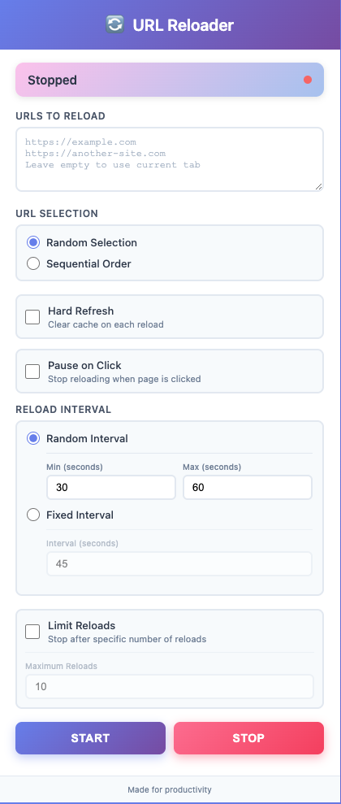

# Random URL Reloader

A Chrome extension that reloads a tab, or rotates it through a list of URLs, on a fixed or random
interval. It shows a live countdown on the page and can stop itself after a set number of reloads,
or as soon as you click the page.

Manifest V3, vanilla JavaScript, no build step and no dependencies. It makes no network requests of
its own and collects nothing.

## What it does

- **Fixed or random interval.** Reload every 45 seconds exactly, or at a random moment between 30 and 60.
- **One page or many.** Leave the list empty to reload the current tab, or give it URLs and visit them in order or at random.
- **Per-tab sessions.** Each tab runs its own list, interval and counter, so three tabs can run three different schedules at once.
- **Reload limit.** Stop automatically after N reloads, with progress shown as `5 / 10`.
- **Pause on click.** Interacting with the page stops the schedule, so it never reloads while you are reading or typing.
- **Hard refresh.** Bypass the cache when the tab reloads the same URL.
- **Live countdown.** A small timer in the corner of the page shows the seconds until the next reload.

## Install

It isn't on the Chrome Web Store yet. Load it unpacked:

1. Clone or download this repository.
2. Open `chrome://extensions` and turn on **Developer mode**.
3. Click **Load unpacked** and choose the folder that contains `manifest.json`.

Works in Chromium browsers: Chrome, Edge, Brave and Opera. Not Firefox, which uses a different extension API.

## Use

1. Open the tab you want to reload and click the extension icon.
2. Optionally enter URLs, one per line, and choose **Random** or **Sequential**.
3. Choose a fixed or random interval, and any options: hard refresh, pause on click, reload limit.
4. Click **Start**. The countdown appears on the page.
5. To stop, open the popup and click **Stop**, click the page if pause on click is on, or let the limit run out.

Settings are saved per tab while you type, so closing the popup loses nothing.

## How it works

| File | Role |
|---|---|
| `manifest.json` | Manifest V3. Permissions: `tabs`, `storage`, `alarms`, plus `<all_urls>` for the on-page countdown. |
| `background.js` | Service worker. Keeps one session per tab and picks the next URL and interval. Reloads with `chrome.tabs.reload`, or navigates with `chrome.tabs.update`. |
| `content.js` / `content.css` | The on-page countdown, pause on click and notifications. Built with `createElement` and `textContent`, never `innerHTML`. |
| `popup.html` / `popup.js` | Settings, validation (only `http` and `https` URLs, intervals of at least one second), start and stop. |

**Surviving service-worker suspension.** Manifest V3 service workers are stopped when idle, which
silently kills a plain `setTimeout`. Each reload is scheduled twice: a `setTimeout` for precise
timing while the worker is alive, and a `chrome.alarms` alarm as a backup that wakes it up again.
Whichever fires first clears the other, and a guard stops a reload from running twice. Sessions are
saved to `chrome.storage.local` and restored when the worker restarts. Tab IDs don't survive a
browser restart, so sessions end when the browser closes.

**Pause on click** listens in the capture phase, so it still fires on pages that stop click events
in their own handlers.

## Develop

Edit the files, then click the reload icon on the extension's card in `chrome://extensions`.

To debug:
- **Popup:** right-click the icon and choose **Inspect popup**.
- **Service worker:** click the **service worker** link on the extension's card.
- **Countdown:** use the page's own DevTools console.

Issues and pull requests are welcome. Please keep it dependency-free.

## License

[MIT](LICENSE) © Techoship LLC. Built by [Muhammad Sulman Gull](https://github.com/msulmangull) at [Techoship](https://techoship.com).
